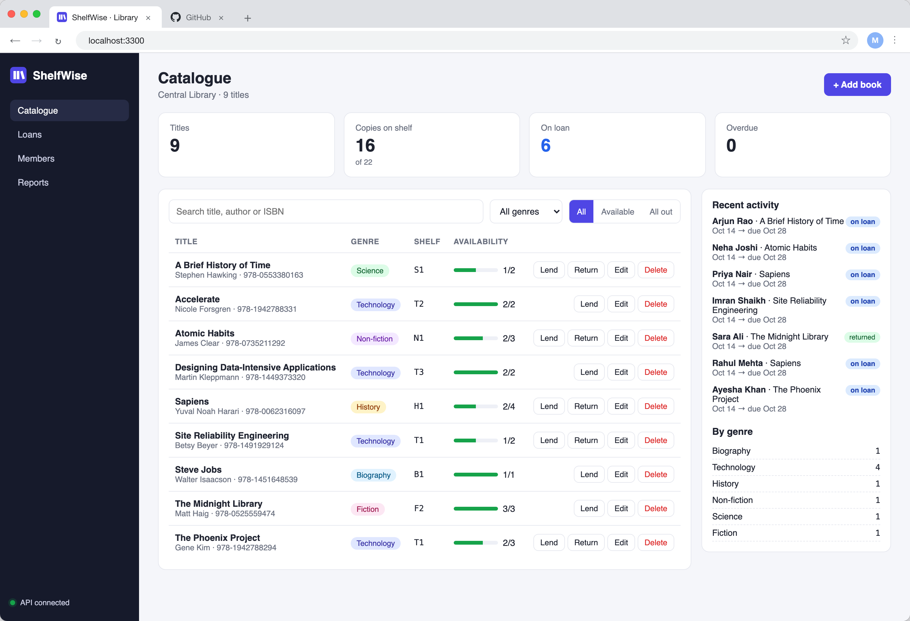

# ShelfWise

ShelfWise is a library management system: a catalogue of books, the copies on each shelf, and who has borrowed what. Librarians search and filter the catalogue, add and edit books, lend copies to borrowers, take them back, and see what is on loan or overdue at a glance.

This repository is my DevOps capstone. The application is mine; around it sits the full delivery path from the course: tests, containers, a CI/CD pipeline with a security gate, a container registry, Terraform for AWS, Kubernetes with Helm, Ingress, autoscaling, and monitoring.

Author: Mohammed Abdurrahman (24BCS10130)



## Architecture

```text
 developer ── git push ──> GitHub ──> GitHub Actions
                                        ├─ test:   pytest (12 cases) + React build
                                        ├─ build:  docker build ──> Trivy gate (HIGH/CRITICAL) ──> push to GHCR
                                        │          images tagged with the commit SHA, amd64 + arm64
                                        └─ deploy: helm upgrade --install into a kind cluster + smoke test via Ingress

 Terraform ──> AWS: VPC (2 public + 2 private subnets, IGW, NAT) ──> EKS cluster + managed node group

 Kubernetes (namespace shelfwise), installed by the Helm chart:
   Ingress shelfwise.local ──  /        ──> frontend Service ──> nginx + React   (2..4 pods, HPA)
                           └── /api     ──> backend Service  ──> FastAPI         (2..6 pods, HPA)
                                                                  │
                                                                  └──> PostgreSQL StatefulSet + PVC
   Prometheus (ServiceMonitor scrapes /metrics) ──> Grafana "ShelfWise API" dashboard
```

## Repository layout

```text
backend/            FastAPI app, SQLAlchemy models, Alembic migrations, pytest suite, Dockerfile
frontend/           React + Vite dashboard, nginx config template, multi-stage Dockerfile
docker-compose.yml  postgres + backend + frontend for local runs
.github/workflows/  ci-cd.yml - the pipeline
terraform/          AWS VPC + EKS (+ emulator/ override used for the recorded runs, see M7)
k8s/                namespace manifest
helm/shelfwise/     the chart: deployments, services, postgres, ingress, HPA, ServiceMonitor
monitoring/         kube-prometheus-stack values and the Grafana dashboard
troubleshooting/    deliberately broken manifests for the failure labs
scripts/            load generator for the HPA and dashboards
docs/screenshots/   evidence referenced below
```

## Grading map

| Module | What is here | Evidence |
|---|---|---|
| M1 Application | FastAPI `/health`, `/ready`, CRUD on `/api/books`, lending, stats; PostgreSQL via Alembic; React UI | [dashboard](docs/screenshots/m1-app-dashboard.png), [add book](docs/screenshots/m1-app-add-book.png), [mobile](docs/screenshots/m1-app-mobile.png), [Swagger](docs/screenshots/m1-api-swagger.png) |
| M2 Testing | 12 pytest cases over 8 endpoints, in-memory SQLite, `pytest.ini` + `conftest.py` | [pytest -v](docs/screenshots/m2-pytest.png) |
| M3 Git | public repo, one commit per step with descriptive messages, `.gitignore` | [commit history](docs/screenshots/m3-commit-history.png) |
| M4 Docker | non-root backend image, multi-stage frontend (node build, nginx runtime), compose | [compose up](docs/screenshots/m4-docker-compose-up.png) |
| M5 CI/CD | pytest, frontend build, both images, GHCR push tagged with the SHA, Helm deploy | [green run](docs/screenshots/m5-pipeline-success.png), [GHCR tags](docs/screenshots/m5-ghcr-packages.png), [packages](docs/screenshots/m5-ghcr-package-list.png) |
| M6 DevSecOps | Trivy on both images, `--exit-code 1` on fixable HIGH/CRITICAL | [Trivy output](docs/screenshots/m6-trivy-scan.png) |
| M7 Terraform | VPC, 2 public + 2 private subnets, NAT, EKS + node group, `tfvars.example` | [plan](docs/screenshots/m7-01-terraform-init-plan.png), [apply](docs/screenshots/m7-02-terraform-apply.png), [EKS](docs/screenshots/m7-03-eks-cluster-and-nodegroup.png), [VPC](docs/screenshots/m7-04-vpc-and-subnets.png), [destroy](docs/screenshots/m7-05-terraform-destroy.png) |
| M8 Kubernetes + Helm | namespace, chart, 2+ replicas each, ClusterIP services, Ingress `/` and `/api`, HPA | [helm](docs/screenshots/m8-helm-upgrade-install.png), [pods/svc](docs/screenshots/m8-pods-svc-ingress.png), [via Ingress](docs/screenshots/m8-app-via-ingress.png), [HPA](docs/screenshots/m8-hpa-scaling.png), [labs](docs/screenshots/troubleshoot-1-broken-image.png) |
| M9 Observability | `/metrics`, Prometheus scraping via ServiceMonitor, Grafana dashboard | [metrics](docs/screenshots/m9-metrics-endpoint.png), [targets UP](docs/screenshots/m9-prometheus-targets.png), [Grafana](docs/screenshots/m9-grafana-dashboard.png) |
| M10 Docs + demo | this README; commit, pipeline, deployment update | [before](docs/screenshots/m10-before-deploy.png), [deploy](docs/screenshots/m10-deploy-cli.png), [after](docs/screenshots/m10-deployment-updated.png) |

## The application

### API

```text
GET    /                       service info
GET    /health                 liveness: the process is up (does not touch the DB)
GET    /ready                  readiness: 503 until PostgreSQL answers
GET    /metrics                Prometheus metrics (requests, latency histograms)
GET    /api/info               library name and the running build (commit SHA)

GET    /api/books              list, with ?q= search, ?genre= and ?available= filters
GET    /api/books/{id}         one book
POST   /api/books              add a book (409 on duplicate ISBN, 422 on invalid input)
PUT    /api/books/{id}         update; total copies cannot drop below copies on loan
DELETE /api/books/{id}         delete; refused while copies are on loan
GET    /api/books/stats        titles, copies, on loan, overdue, count by genre

POST   /api/books/{id}/checkout   lend a copy to a borrower
POST   /api/loans/{id}/return     return it
GET    /api/loans                 recent loans for the activity feed
```

Interactive docs are at `/docs` (Swagger).

### Database

Two tables, `books` and `loans`, created by Alembic migration `0001`; migration `0002` seeds a starter catalogue so a fresh install is not an empty page. Check constraints keep `available_copies` between 0 and `total_copies` at the database level, not only in Python.

Migrations run when the backend starts. Several replicas start at once in Kubernetes, so `alembic/env.py` takes a PostgreSQL advisory lock first and the replicas migrate one at a time.

### Run it locally

```bash
docker compose up --build
# UI       http://localhost:3000
# API      http://localhost:8000/docs
```

Ports are configurable (`FRONTEND_PORT=3300 BACKEND_PORT=8800 docker compose up --build`) for machines where 3000/8000 are taken, which is how the screenshots were taken.

### Tests

```bash
cd backend
pip install -r requirements-dev.txt
pytest -v
```

`tests/conftest.py` overrides the FastAPI `get_db` dependency so every test runs against a fresh in-memory SQLite database. The real PostgreSQL is never touched.

## Docker

The backend image is `python:3.12-slim` with OS packages upgraded at build time, dependencies installed before the code is copied (better layer caching), and runs as uid 10001. The frontend image builds the React app in `node:22-alpine` and copies only `dist/` into `nginxinc/nginx-unprivileged`, which runs as uid 101 on port 8080; Node never reaches the runtime image. nginx proxies `/api` to the backend, with the backend address injected from `BACKEND_URL` through nginx's template mechanism, so the same image works in compose and in Kubernetes.

## CI/CD

`.github/workflows/ci-cd.yml` runs on every push and pull request to `main`:

1. **test**: install backend deps, run `pytest -v` (a failure stops the pipeline), then `npm ci && npm run build` for the frontend.
2. **build** (matrix: backend, frontend): build the image, scan it with Trivy, and only if the scan passes, push it to GHCR as `ghcr.io/abdurrahmaan11265/shelfwise-<component>:<commit SHA>`. Images are multi-arch (amd64 for EKS nodes, arm64 for Apple silicon and Graviton). No `latest` tag is used.
3. **deploy**: create a kind cluster on the runner with the nginx ingress controller and metrics-server, load the images that were just pushed, `helm upgrade --install` the chart with the SHA tags, then smoke-test through the Ingress: read stats, load the UI, create a book, and read it back.

The SHA tag gives traceability: any running pod's image names the exact commit it came from, and the UI shows it in the sidebar.

Two real bugs were caught by this pipeline during development, both visible in the run history: the Ingress was rejected by ingress-nginx's strict path validation (`/openapi.json` with `pathType: Exact`), and the migrations were silently rolled back because the advisory-lock query had opened the transaction Alembic ran inside. The smoke test caught the second as a 500 from `/api/books/stats`; it is fixed by committing explicitly after the migrations.

## Security scanning (Trivy)

Each image is scanned with `aquasec/trivy` in the pipeline:

```bash
trivy image --severity HIGH,CRITICAL --ignore-unfixed --exit-code 1 <image>
```

Trivy inspects the OS packages of the image (Debian for the backend, Alpine for the frontend) and the language packages installed in it (the Python wheels in the backend) against vulnerability databases. `--exit-code 1` makes any HIGH or CRITICAL finding with an available fix fail the job, and because the push step comes after the scan, a failing image is never published. `--ignore-unfixed` keeps the gate actionable: findings with no upstream fix are reported but cannot block a release.

The result for both images is clean, zero fixable HIGH or CRITICAL findings. That is by design rather than luck: both Dockerfiles upgrade the base image's OS packages at build time (`apt-get upgrade` / `apk upgrade`), because base images routinely trail the distribution's security fixes by days, and the Python dependencies are pinned to current releases. A clean scan means no known, fixable, serious vulnerability at build time; it is not a guarantee of security, which is why it sits alongside tests, non-root containers and least-privilege defaults rather than replacing them.

## Terraform (AWS VPC + EKS)

```text
terraform/
  versions.tf               terraform >= 1.5, aws provider ~> 5.80
  providers.tf              region from a variable; credentials from the environment, never the repo
  variables.tf              region, CIDRs, Kubernetes version, node sizes
  vpc.tf                    VPC, IGW, 2 public + 2 private subnets across 2 AZs, NAT gateway, route tables
  eks.tf                    IAM roles and policies, EKS cluster, managed node group in the private subnets
  outputs.tf                ids, cluster endpoint, and the aws eks update-kubeconfig command
  terraform.tfvars.example  copy to terraform.tfvars (git-ignored)
```

Subnets carry the `kubernetes.io/role/elb` and `internal-elb` tags so the AWS load balancer controller can place load balancers for the Ingress. Worker nodes live in the private subnets and reach the internet through the NAT gateway.

```bash
cd terraform
cp terraform.tfvars.example terraform.tfvars
terraform init && terraform plan -out=tfplan && terraform apply tfplan
aws eks update-kubeconfig --region ap-south-1 --name shelfwise-eks
terraform destroy
```

### How the recorded runs were done

I did not have an AWS account available while building this, so the recorded `plan`, `apply` and `destroy` were run against [Moto](https://github.com/getmoto/moto), an AWS API emulator, rather than real AWS. The free edition of LocalStack does not implement EKS; Moto does. `emulator/emulator_override.tf` is copied into `terraform/` for those runs; Terraform merges it over `providers.tf` and sends the API calls to `localhost:5055`. The `.tf` files themselves are unchanged. Delete the override and the same configuration targets real AWS.

What this shows: the configuration is valid, the plan is correct (22 resources), every resource including the EKS cluster and the node group is created through the real AWS API calls and dependency order, and `destroy` removes all of it. What it does not show: a real EKS control plane and EC2 worker nodes. The recorded resources carry the emulator's placeholder account ID `123456789012`, and there are no AWS Console screenshots, because the infrastructure was not created in a real account. The Kubernetes deployment below therefore runs on a local minikube cluster; on EKS the same Helm command applies after `aws eks update-kubeconfig`.

## Kubernetes and Helm

```bash
kubectl apply -f k8s/namespace.yaml
helm upgrade --install shelfwise ./helm/shelfwise -n shelfwise \
  --set backend.image.tag=<commit SHA> --set frontend.image.tag=<commit SHA>
```

The chart installs:

- backend Deployment (2-6 replicas via HPA at 60% CPU) with startup, readiness (`/ready`) and liveness (`/health`) probes, non-root, resource requests and limits
- frontend Deployment (2-4 replicas via HPA)
- ClusterIP Services for backend, frontend and PostgreSQL
- PostgreSQL StatefulSet with a PersistentVolumeClaim; its password is generated once by the chart and kept across upgrades, so no password is committed
- Ingress for `shelfwise.local`: `/api`, `/docs` and `/openapi.json` to FastAPI, everything else to the React frontend
- ServiceMonitor so Prometheus scrapes `/metrics` on every backend pod

Under the load generator (`scripts/load-test.sh`), the backend HPA scaled from 2 to 6 replicas at 436% of target CPU; see [HPA](docs/screenshots/m8-hpa-scaling.png).

## Monitoring

```bash
kubectl create secret generic grafana-admin -n monitoring \
  --from-literal=admin-user=admin --from-literal=admin-password="$(openssl rand -hex 12)"
helm install monitoring prometheus-community/kube-prometheus-stack \
  -n monitoring -f monitoring/kube-prometheus-stack-values.yaml
kubectl apply -f monitoring/grafana-dashboard.yaml
```

The backend exposes `/metrics` through `prometheus-fastapi-instrumentator`: request counts by method, handler and status class, and latency histograms. Prometheus discovers the backend pods through the chart's ServiceMonitor. The **ShelfWise API** Grafana dashboard (provisioned from a ConfigMap) shows request rate, p95 latency, 5xx error rate, available backend pods, requests by endpoint, latency by endpoint, responses by status class, and per-pod CPU, which is the HPA's input.

## Troubleshooting labs

`troubleshooting/` holds three broken manifests, each run and fixed on the cluster:

1. **broken-image.yaml**: a rollout to a tag that was never pushed. New pods go to `ErrImagePull`/`ImagePullBackOff` while the old pods keep serving; the `Failed` event names the missing tag; `kubectl rollout undo` restores the previous ReplicaSet. [capture](docs/screenshots/troubleshoot-1-broken-image.png)
2. **broken-service.yaml**: a Service with a one-letter selector typo. It has a ClusterIP but no endpoints, so connections are refused; comparing the selector with the pod labels shows the typo; patching the selector fixes it. [capture](docs/screenshots/troubleshoot-2-broken-service.png)
3. **broken-readiness.yaml**: a readiness probe on `/readyz`, which the API does not serve. The new pod is `Running` but `0/1`, its events show `Readiness probe failed: HTTP probe failed with statuscode: 404`, and its IP is missing from the Service endpoints, so the rollout stalls while the old pods keep serving; `kubectl rollout undo` fixes it. [capture](docs/screenshots/troubleshoot-3-broken-readiness.png)

## Demo: commit to deployment

The last feature was added the way the demo runs: a change to show the running build in the UI (`/api/info` plus the sidebar), committed and pushed as `0c9b52a`.

1. [Before](docs/screenshots/m10-before-deploy.png): the cluster runs the previous build and the sidebar has no build line.
2. The pipeline for `0c9b52a` tested it (12 tests), built and Trivy-scanned both images, pushed them as `:0c9b52a4c7…`, and deployed them to its own kind cluster.
3. [Deploy](docs/screenshots/m10-deploy-cli.png): `helm upgrade --install` with the new SHA rolls the pods; the deployment's image changes from `e3d3fcb` to `0c9b52a` and `/api/info` reports the new version.
4. [After](docs/screenshots/m10-deployment-updated.png): the same page through the Ingress now shows `build 0c9b52a`.

One gotcha worth knowing: Helm 4 uses server-side apply, so after a manual `kubectl rollout undo` (as in the troubleshooting labs) kubectl owns the image field and the next `helm upgrade` reports a field-manager conflict. `helm upgrade --force-conflicts` hands ownership back to Helm.
